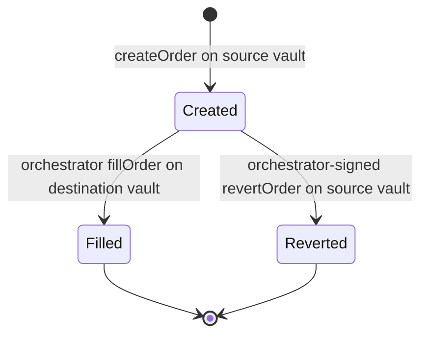

An order is in exactly one of four states, and only two transitions are possible after creation: filled on the destination chain, or reverted on the source chain. Funds are never stuck in an intermediate state; the vault either delivers or refunds.

| State | Read from | Meaning for the user |
| --- | --- | --- |
| `Created` | Source vault `orderStatus(hash) == 1`, `OrderCreated` event | USDC is locked; the fill is pending |
| `Filled` | Destination vault `orderStatus(hash) == 2`, `OrderFilled` event | Tokens delivered to `receiver`; `effectiveAmountOut` is the amount actually received |
| `Reverted` | Source vault `orderStatus(hash) == 3`, `OrderReverted` event | `amountIn - fee` returned to `trader` on the source chain |

**Timing.** Fill latency is the source chain's finality wait plus one destination-chain transaction. Ethereum as a source is the slowest leg; L2 to L2 and Solana routes are the fastest.

## When an order reverts

- Destination liquidity is below the order amount and cannot be rebalanced in time.
- The destination swap cannot reach `minAmountOut` at execution time because the price moved past the user's slippage.
- The destination chain is paused, or the destination call is invalid.

The refund keeps the fee, so partners should surface the fee as non-refundable in their UI and keep `slippage` realistic to avoid reverts on volatile pairs.

## Partial success

`OrderFilled.success == false` means the optional destination call reverted after `tokenOut` was already delivered to the receiver. The swap and transfer are final; only the follow-up action failed.

## Tracking options

1. **On-chain.** Watch `OrderCreated` on the source vault, then poll `orderStatus(orderHash)` on the destination vault and, if it stays `0` beyond your timeout, on the source vault for `Reverted`.
2. **Monitoring API.** `GET /monitoring/orders?orderHash=...`, also filterable by `transactionHash`, `traders[]`, `status`, `networkIn`, `networkOut`, paginated with `limit` and `offset`. Each row includes `orderCreatedTxHash`, `orderFilledTxHash`, both timestamps, `effectiveAmountOut` and `amountInValueUsd`. The public host for this API is shared at onboarding. A websocket feed with the same rows is available for wallets that want push updates.

## Idempotency

The seed is the replay guard. Reuse of a seed with identical parameters reverts with `InvalidOrderStatus`, so a partner that retries a failed broadcast can safely resend the same calldata.
