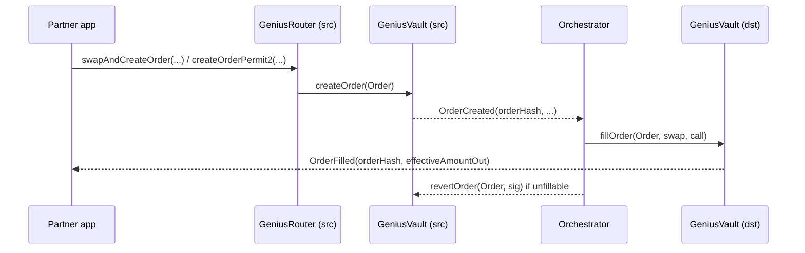

Genius is an intent-based cross-chain swap and bridge protocol. A partner submits a user's intent (token in on chain A, token out to a receiver on chain B, a minimum amount out) as an on-chain **order**. Genius orchestrators fill it on the destination chain from protocol-owned stablecoin liquidity, so the user never touches a bridge or a destination-chain transaction.

## How it works

- Every chain runs a `GeniusVault` holding USDC liquidity. Orders are denominated in the vault stablecoin. Any other input token is swapped into USDC on the source chain in the same transaction, and any output token is swapped out of USDC on the destination chain by the orchestrator.
- `GeniusRouter` is the partner entry point. It pulls the user's tokens (standard approval or Permit2), runs the source swap through `GeniusProxyCall`, and calls `createOrder` on the vault.
- Orchestrators watch `OrderCreated` events and call `fillOrder` on the destination vault. The order settles when `OrderFilled` is emitted there. If it cannot be filled, an orchestrator-signed `revertOrder` refunds the trader on the source chain.
- `GeniusGasTank` lets a relayer sponsor gas for a user who only signs Permit2 and an order signature (gasless mode).
- Solana runs an equivalent Anchor program with `create_order` and `fill_order` instructions, so EVM-to-Solana and Solana-to-EVM orders use the same order model. Addresses are carried as 32-byte values on every chain for this reason.

A partner integrates at the top of that diagram: obtain a quote, build the router transaction, have the user sign it, then track the order hash until it is filled or reverted.

## Actors

| Actor | Who | Role |
| --- | --- | --- |
| Trader | The partner's user | Owns the input tokens, signs the source-chain transaction |
| Receiver | Any address on the destination chain | Gets the output tokens; usually the trader |
| Partner | Wallets and aggregators | Requests quotes, builds and submits transactions, tracks orders |
| Orchestrator | Genius-operated, `ORCHESTRATOR_ROLE` on every vault | Fills orders on the destination chain, reverts unfillable ones, rebalances liquidity |
| Admin / Pauser | Genius multisig | Upgrades (UUPS), parameters, emergency pause |

## Integration paths

Use the quoting API. It returns ready-to-send calldata for every chain, computes the exact fee, and handles the Permit2 typed data. Direct contract calls are supported but you then own fee computation, swap routing into USDC, and seed generation.

| Path | What you call | What you build yourself | Best for |
| --- | --- | --- | --- |
| Quoting API (recommended) | `POST /quoting/price` then `POST /quoting/quote`, submit the returned payloads | Nothing on-chain. Optional Permit2 signature | Wallets, aggregators, any partner that wants every supported token pair |
| SDK | `genius-bridge-sdk` on npm, a typed client over the same two endpoints | Same as above | TypeScript integrators |
| Direct contracts | `GeniusRouter.swapAndCreateOrder` or `GeniusVault.createOrder` on the source chain | Fee lookup via `FeeCollector.getOrderFees`, source-chain swap calldata, unique seed, bytes32 encoding | Partners with their own routing who only want USDC in |

Whatever the path, the on-chain result is identical: one `OrderCreated` event on the source chain, one `OrderFilled` (or `OrderReverted`) event later. Tracking works the same way for all three.
