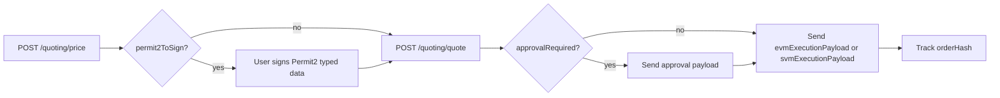

Two POST calls give you an executable transaction: `price` returns amounts and fees, `quote` returns calldata.

Base URL: `https://bridge-api.tradegeniuses.net/quoting`

No authentication header is required today; partner API keys are issued at onboarding.



**Chain ids** are the EVM chain ids from the deployments table, and `1399811149` for Solana.

**Native tokens** are addressed as `0xEeeeeEeeeEeEeeEeEeEeeEEEeeeeEeeeeeeeEEeE` on EVM and `So11111111111111111111111111111111111111112` on Solana.

**Amounts** are strings in base units.

## `POST /quoting/price`

| Field | Type | Required | Meaning |
| --- | --- | --- | --- |
| `networkIn`, `networkOut` | number | yes | Source and destination chain ids; must differ |
| `tokenIn`, `tokenOut` | string | yes | Token addresses on their respective chains |
| `amountIn` | string | yes | Input amount in base units |
| `from` | string | recommended | Trader address; needed to build `permit2ToSign` |
| `slippage` | number | no | Percent, 0 to 100 |
| `callTarget`, `callData` | string | no | Arbitrary call the orchestrator executes on the destination after delivering `tokenOut` |
| `maxAccounts` | number | no | Solana account budget hint for the Jupiter route |

Response (`GeniusBridgePriceResponse`): `requestId`, `amountOut`, `minAmountOut`, `slippage`, `fee`, `feesDetails { base, bps, insurance, swapOut, call, total }`, `tokenInPriceUsd`, `tokenOutPriceUsd`, `swapInAmountOut`, `swapOutAmountOut`, and `permit2ToSign { types, domain, message }` when the source chain is EVM and `from` was given. All fee fields are in source-chain USDC base units.

## `POST /quoting/quote`

Send every `price` field plus:

| Field | Type | Required | Meaning |
| --- | --- | --- | --- |
| `priceResponse` | object | yes | The full `price` response, echoed back |
| `from` | string | yes | Trader address on the source chain |
| `to` | string | no | Receiver on the destination chain; defaults to `from` |
| `permit` | `{ signature, permitBatch }` | no | Signed Permit2 data from `permit2ToSign`; omit to use standard approvals |
| `authority` | `{ networkInAddress, networkOutAddress }` | no | Override signer addresses for smart-account setups |

Response (`GeniusBridgeQuoteResponse`): everything from `price` plus:

- `seed`
- `evmExecutionPayload { to, data, value, gasLimit?, gasPrice? }` for EVM sources
- `svmExecutionPayload: string[]` (base64 serialized transactions to sign and send in order) for Solana sources
- `approvalRequired { spender, amount, payload } | null`

When `approvalRequired` is set, send its `payload` and wait for confirmation before sending the execution payload.

`seed` and `from` let you recompute `orderHash` locally, or you can read it from the `OrderCreated` log of the execution transaction.

<Note>
A quote embeds swap calldata from third-party aggregators. Re-quote when the user has idled, and never reuse a quote across sessions. The on-chain `minAmountOut` protects against stale prices regardless.
</Note>

## SDK

```bash
npm install genius-bridge-sdk
```

```ts
import { GeniusBridgeSdk } from 'genius-bridge-sdk';

const sdk = new GeniusBridgeSdk(); // { geniusBridgeBaseUrl } to point at staging

const params = {
  networkIn: 8453,
  networkOut: 42161,
  tokenIn: '0x833589fCD6eDb6E08f4c7C32D4f71b54bdA02913',
  tokenOut: '0xaf88d065e77c8cC2239327C5EDb3A432268e5831',
  amountIn: '100000000',
  slippage: 0.5,
  from: userAddress,
};

const price = await sdk.fetchPrice(params);
const quote = await sdk.fetchQuote({ ...params, priceResponse: price, to: userAddress });

// 1. if (quote.approvalRequired) send quote.approvalRequired.payload
// 2. send quote.evmExecutionPayload
```

The SDK validates chains and address formats client-side and otherwise maps one-to-one onto the two endpoints, so any HTTP client works equally well. Partners routing across several bridges can use the `genius-intents` package instead, which wraps this SDK alongside other providers with the same `fetchPrice` and `fetchQuote` shape.
